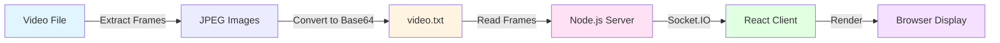
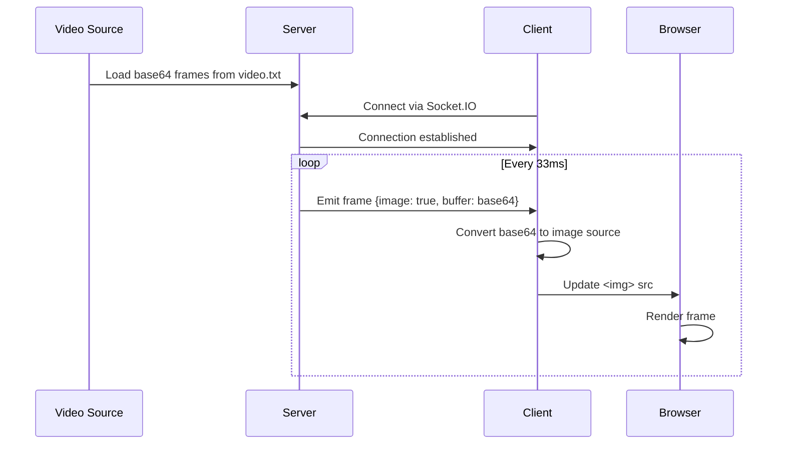
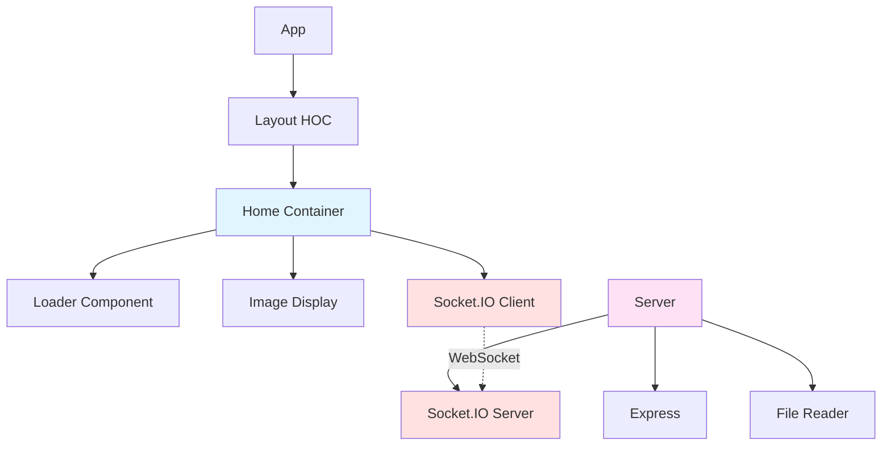

# Stream Images

A real-time video streaming application that streams base64-encoded video frames from a Node.js server to a React.js client using Socket.IO WebSockets.

Built in December 2018. This project demonstrates real-time frame streaming to create a video playback experience in the browser without traditional video file formats.

## Features

- 🎥 Real-time frame streaming via WebSocket (Socket.IO)
- 📡 Server-side frame management and distribution
- ⚛️ React.js client with dynamic image rendering
- 🔄 Automatic reconnection handling
- ⏱️ Configurable frame rate (~30 fps default)
- 🖼️ Base64 image encoding for frame transmission
- 📦 Separate client and server architecture

## Architecture



## Data Flow



## Component Architecture



## Getting Started

### Prerequisites

- Node.js (v8 or higher)
- npm (comes with Node.js)
- Modern web browser

### Installation

1. Clone the repository:
```bash
git clone https://github.com/orassayag/stream-images.git
cd stream-images
```

2. Install server dependencies:
```bash
cd server
npm install
```

3. Install client dependencies:
```bash
cd ../client
npm install
```

### Running the Application

1. Start the server (in the server directory):
```bash
npm start
```
The server will run on `http://localhost:3000`

2. Start the client (in a new terminal, in the client directory):
```bash
npm start
```
The client will automatically open in your browser at `http://localhost:3001`

### Configuration

**Server** (`server/index.js`):
- Frame rate: Adjust the interval value (default: 33ms = ~30fps)
- Port: Change the port number in `http.listen()`

**Client** (`client/src/settings/`):
- API endpoint: Update `api_base_url` in settings files

## Project Structure

```
stream-images/
├── client/                  # React.js frontend
│   ├── public/             # Static assets
│   ├── src/
│   │   ├── components/     # Reusable React components
│   │   ├── containers/     # Container components (Home)
│   │   ├── hoc/            # Higher-order components (Layout)
│   │   ├── settings/       # Environment configurations
│   │   └── utils/          # Utility functions
│   └── package.json
├── server/                  # Node.js backend
│   ├── index.js            # Main server file
│   ├── video.txt           # Base64 encoded frames (not in repo)
│   └── package.json
└── README.md
```

## How It Works

### Frame Preparation

1. Extract frames from a video file using FFmpeg:
```bash
ffmpeg -i input_video.mp4 -vf fps=30 images/frame_%04d.jpg
```

2. Convert frames to base64 and store in `video.txt` (see server code comments)

### Server Operation

1. Reads pre-converted base64 frames from `video.txt`
2. Splits frames using `#` delimiter
3. Establishes Socket.IO connection with clients
4. Emits frames sequentially at configured intervals

### Client Operation

1. Connects to server via Socket.IO
2. Listens for `image` events
3. Converts base64 data to image source
4. Updates the DOM with the new frame

## Built With

* [React.js](https://reactjs.org) - Frontend framework
* [Node.js](https://nodejs.org/en) - Backend runtime
* [Socket.IO](https://socket.io/) - Real-time bidirectional event-based communication
* [Express](https://expressjs.com/) - Web framework for Node.js
* [LESS](http://lesscss.org/) - CSS preprocessor
* [Webpack](https://webpack.js.org/) - Module bundler

## Available Scripts

### Client

- `npm start` - Start development server
- `npm run build` - Build for production
- `npm test` - Run tests

### Server

- `npm start` - Start the server

## Contributing

Contributions are welcome! Please read [CONTRIBUTING.md](CONTRIBUTING.md) for details on the code of conduct and the process for submitting pull requests.

## Versioning

We use [SemVer](http://semver.org) for versioning. For the versions available, see the [tags on this repository](https://github.com/orassayag/stream-images/tags).

## Author

* **Or Assayag** - *Initial work* - [orassayag](https://github.com/orassayag)
* Or Assayag <orassayag@gmail.com>
* GitHub: https://github.com/orassayag
* StackOverflow: https://stackoverflow.com/users/4442606/or-assayag?tab=profile
* LinkedIn: https://linkedin.com/in/orassayag

## License

This application has an MIT license - see the [LICENSE](LICENSE) file for details.
