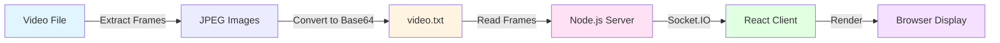
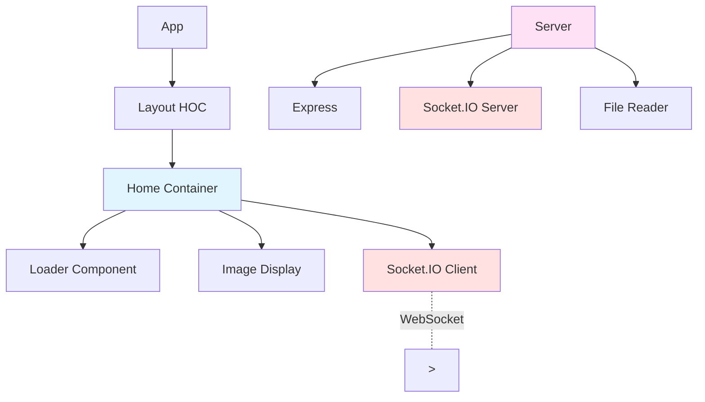

# Stream Images

A real-time video streaming application built with Node.js, React.js, Express, and Socket.IO that recreates video playback by transmitting base64-encoded image frames over WebSockets. The server reads preprocessed frames, streams them to connected clients at a configurable frame rate, and manages real-time delivery, while the React frontend renders each frame dynamically in the browser.

Built in December 2018, it demonstrates WebSocket communication, event-driven architecture, frame synchronization, automatic reconnection, and custom media streaming without traditional video formats.

## Features

- 🎥 Real-time frame streaming via WebSocket (Socket.IO)
- 📡 Server-side frame management and distribution
- ⚛️ React.js client with dynamic image rendering
- 🔄 Automatic reconnection handling
- ⏱️ Configurable frame rate (~30 fps default)
- 🖼️ Base64 image encoding for frame transmission
- 📦 Separate client and server architecture

### Core Capabilities

- **Real-time streaming**: Base64 frame delivery over Socket.IO
- **Frame synchronization**: Configurable playback rate (30fps default)
- **Client-server architecture**: Separate React frontend and Node.js backend
- **Automatic reconnection**: Handles client disconnections gracefully
- **Dynamic rendering**: React updates images as frames arrive

### Technical Excellence

- **Event-driven design**: Socket.IO for real-time bidirectional communication
- **Modular architecture**: Clear separation between client and server
- **Configuration management**: Environment-specific settings for client
- **Dependency management**: npm for package management
- **Modern frontend**: React with component-based architecture

### Developer Experience

- **Development servers**: Hot reloading for both client and server
- **Environment configurations**: Development and production settings
- **Clear project structure**: Organized directories for easy navigation
- **Well-documented code**: Comments and structure for maintainability

## Architecture



### Architecture Principles

This project follows clean architecture principles:

1. **Separation of Concerns**: Clear separation between client (presentation layer) and server (backend logic)
2. **Event-driven Communication**: Socket.IO for real-time bidirectional communication
3. **Modular Design**: Reusable React components and server-side modules
4. **Configuration Management**: Environment-specific settings
5. **Testability**: Clear code structure for easy testing and maintenance

### Design Patterns

- **Observer Pattern**: Socket.IO for real-time event handling
- **Component Pattern**: React for modular UI development
- **Module Pattern**: Node.js modules for server organization
- **Factory Pattern**: Component creation and initialization

## Data Flow

```mermaid
sequenceDiagram
    participant V as Video Source
    participant S as Server
    participant C as Client
    participant B as Browser

    V->>S: Load base64 frames from video.txt
    C->>S: Connect via Socket.IO
    S->>C: Connection established
    loop Every 33ms
        S->>C: Emit frame {image: true, buffer: base64}
        C->>C: Convert base64 to image source
        C->>B: Update &lt;img&gt; src
        B->>B: Render frame
    end
```

## Component Architecture



## Getting Started

### Prerequisites

- Node.js (v8 or higher)
- npm (comes with Node.js)
- Modern web browser

### Installation

1. Clone the repository:

```bash
git clone https://github.com/orassayag/stream-images.git
cd stream-images
```

2. Install server dependencies:

```bash
cd server
npm install
```

3. Install client dependencies:

```bash
cd ../client
npm install
```

## Usage

### Running the Application

1. Start the server (in the server directory):

```bash
npm start
```

The server will run on `http://localhost:3000`

2. Start the client (in a new terminal, in the client directory):

```bash
npm start
```

The client will automatically open in your browser at `http://localhost:3001`

### Configuration

**Server** (`server/index.js`):

- Frame rate: Adjust the interval value (default: 33ms = ~30fps)
- Port: Change the port number in `http.listen()`

**Client** (`client/src/settings/`):

- API endpoint: Update `api_base_url` in settings files

## Development

### Code Quality

**Linting:**

```bash
# Server
cd server
npm run lint

# Client
cd client
npm run lint
```

**Building for Production:**

```bash
# Client
cd client
npm run build
```

### Testing

1. Start both server and client
2. Open browser developer console
3. Verify Socket.IO connection is established
4. Check for any console errors
5. Observe frame streaming in the network tab

## Directory Structure

```
stream-images/
├── client/                          # React.js frontend
│   ├── public/                      # Static assets
│   ├── src/
│   │   ├── components/              # Reusable React components
│   │   │   └── UI/
│   │   │       └── Loader/
│   │   ├── containers/              # Container components (Home)
│   │   ├── hoc/                     # Higher-order components (Layout)
│   │   ├── settings/                # Environment configurations
│   │   └── utils/                   # Utility functions
│   ├── config/                      # Webpack and Jest configs
│   ├── scripts/                     # Build and dev scripts
│   └── package.json
├── server/                          # Node.js backend
│   ├── index.js                     # Main server file
│   ├── video.txt                    # Base64 encoded frames (not in repo)
│   ├── images/                      # Source images for conversion
│   └── package.json
├── .github/                         # GitHub configuration
├── .vscode/                         # VS Code settings
├── .gitignore
├── .prettierrc
├── CHANGELOG.md
├── CODE_OF_CONDUCT.md
├── CONTRIBUTING.md
├── INSTRUCTIONS.md
├── LICENSE
├── README.md
└── SECURITY.md
```

## How It Works

### Frame Preparation

1. Extract frames from a video file using FFmpeg:

```bash
ffmpeg -i input_video.mp4 -vf fps=30 images/frame_%04d.jpg
```

2. Convert frames to base64 and store in `video.txt` (see server code comments)

### Server Operation

1. Reads pre-converted base64 frames from `video.txt`
2. Splits frames using `#` delimiter
3. Establishes Socket.IO connection with clients
4. Emits frames sequentially at configured intervals

### Client Operation

1. Connects to server via Socket.IO
2. Listens for `image` events
3. Converts base64 data to image source
4. Updates the DOM with the new frame

## Built With

- [React.js](https://reactjs.org) - Frontend framework
- [Node.js](https://nodejs.org/en) - Backend runtime
- [Socket.IO](https://socket.io/) - Real-time bidirectional event-based communication
- [Express](https://expressjs.com/) - Web framework for Node.js
- [LESS](http://lesscss.org/) - CSS preprocessor
- [Webpack](https://webpack.js.org/) - Module bundler

## Available Scripts

### Client

- `npm start` - Start development server
- `npm run build` - Build for production
- `npm test` - Run tests

### Server

- `npm start` - Start the server

## Best Practices

### Before Modifying

1. **Understand the Architecture**: Review the architecture diagrams and documentation
2. **Test Changes Locally**: Always test changes before committing
3. **Follow Code Style**: Use existing ESLint and Prettier configurations
4. **Update Documentation**: Update README and INSTRUCTIONS.md when adding features

### Development Best Practices

1. **Environment Management**: Use development environment for testing
2. **Code Quality**: Run linting before committing
3. **Version Control**: Follow SemVer for versioning
4. **Security**: Never commit sensitive data

### Operational Best Practices

1. **Performance**: Optimize frame size and quality for better streaming
2. **Monitoring**: Check console logs for errors
3. **Maintenance**: Keep dependencies updated

## Contributing

Contributions are welcome! Please read [CONTRIBUTING.md](CONTRIBUTING.md) for details on the code of conduct and the process for submitting pull requests.

## Versioning

We use [SemVer](http://semver.org) for versioning. For the versions available, see the [tags on this repository](https://github.com/orassayag/stream-images/tags).

## Support

For questions, issues, or contributions:

- **GitHub Issues**: [https://github.com/orassayag/stream-images/issues](https://github.com/orassayag/stream-images/issues)
- **Email**: orassayag@gmail.com

## Author

- **Or Assayag** - _Initial work_ - [orassayag](https://github.com/orassayag)
- Or Assayag <orassayag@gmail.com>
- GitHub: https://github.com/orassayag
- StackOverflow: https://stackoverflow.com/users/4442606/or-assayag?tab=profile
- LinkedIn: https://linkedin.com/in/orassayag

## License

This application has an MIT license - see the [LICENSE](LICENSE) file for details.

## Acknowledgments

- Built for educational and research purposes
- Respects robots.txt and implements rate limiting
- Uses user-agent rotation to avoid detection
- Implements polite crawling practices
